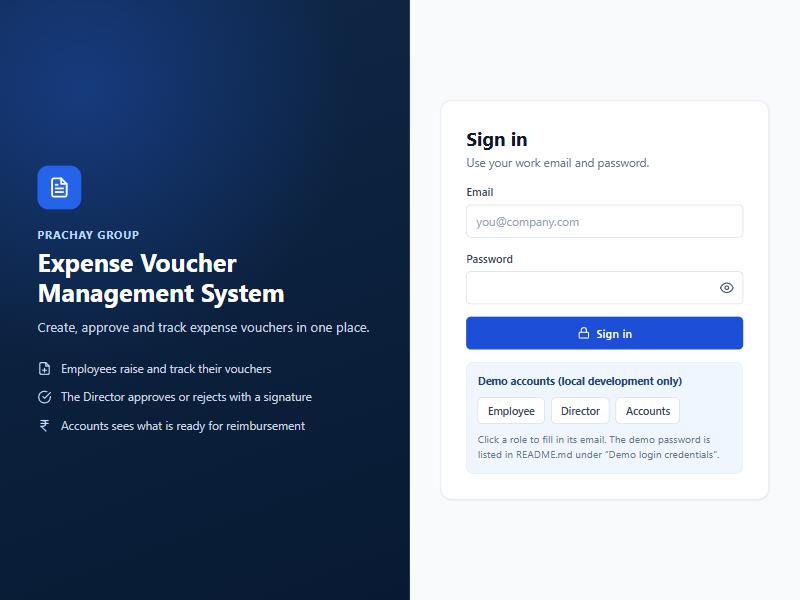
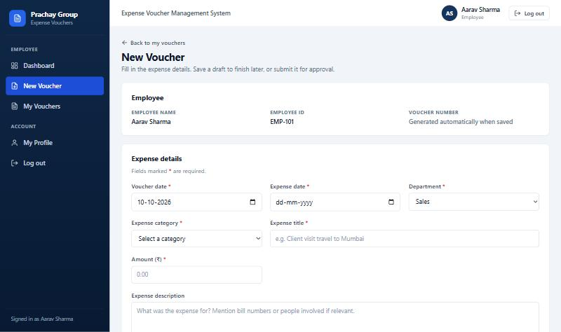
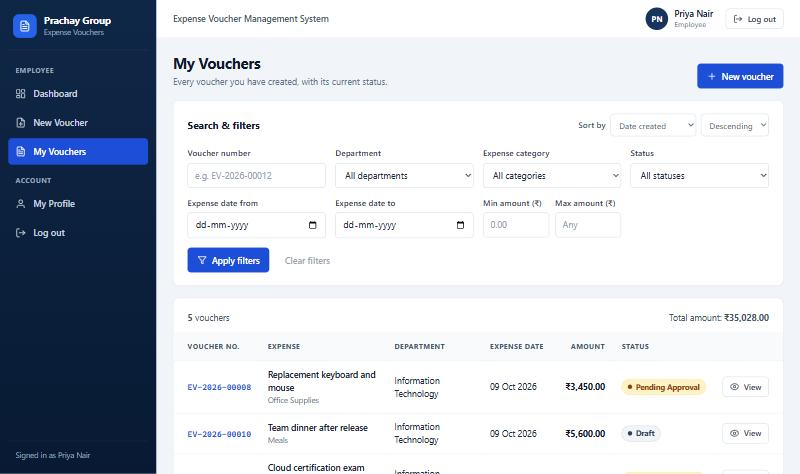
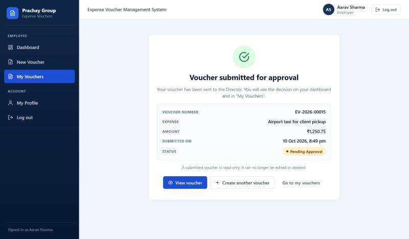
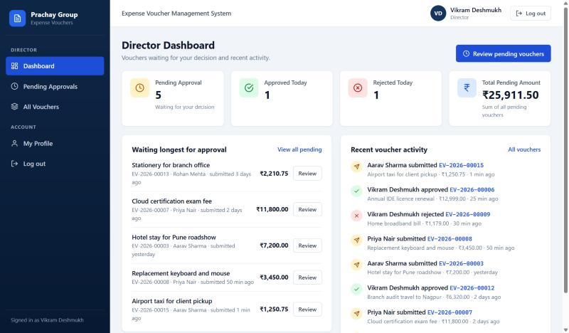
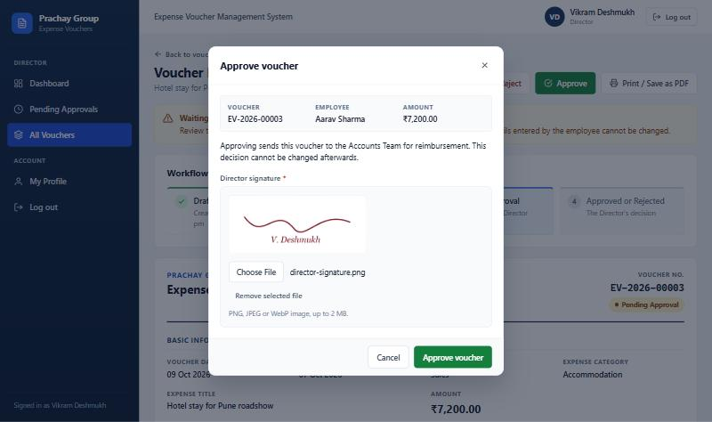
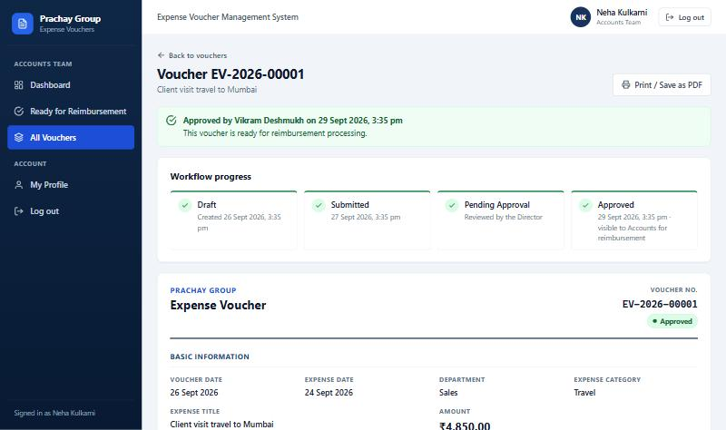
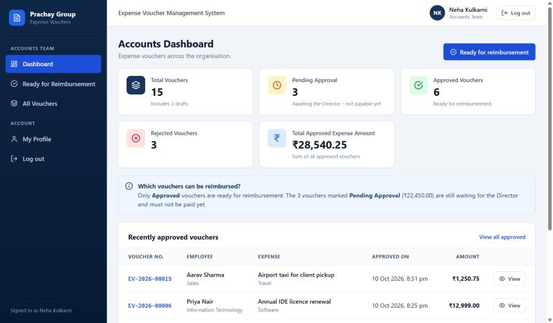

# Expense Voucher Management System

A full-stack web application that replaces a paper expense-voucher process.
Employees raise expense vouchers, the Director approves or rejects them with a signature,
and the Accounts Team sees which vouchers are ready for reimbursement.

Built for the Full Stack Developer Internship assignment (Prachay Securities Private Limited).

| | |
|---|---|
| **Frontend** | React 19 (Vite), React Router, Axios, plain CSS |
| **Backend** | Node.js, Express 5, JWT, bcrypt, Multer |
| **Database** | MySQL 8 (`mysql2` driver) |
| **Automated tests** | 69 API tests (Node's built-in test runner) against a real MySQL database |

---

## Contents

1. [What the application does](#1-what-the-application-does)
2. [Technology stack](#2-technology-stack)
3. [Prerequisites](#3-prerequisites)
4. [Folder structure](#4-folder-structure)
5. [Setup - step by step (Windows PowerShell)](#5-setup---step-by-step-windows-powershell)
6. [Environment variables](#6-environment-variables)
7. [Demo login credentials](#7-demo-login-credentials)
8. [Features by role](#8-features-by-role)
9. [Voucher workflow](#9-voucher-workflow)
10. [Database schema explanation](#10-database-schema-explanation)
11. [API documentation](#11-api-documentation)
12. [Security and validation](#12-security-and-validation)
13. [How the pieces work together](#13-how-the-pieces-work-together)
14. [Running the tests](#14-running-the-tests)
15. [Troubleshooting](#15-troubleshooting)
16. [Assumptions made during development](#16-assumptions-made-during-development)
17. [Enhancements beyond the brief](#17-enhancements-beyond-the-brief)
18. [Known limitations](#18-known-limitations)
19. [Publishing to GitHub](#19-publishing-to-github)

More detail lives in the `docs` folder:
[API_DOCUMENTATION.md](docs/API_DOCUMENTATION.md) ·
[DATABASE_SCHEMA.md](docs/DATABASE_SCHEMA.md) ·
[TESTING.md](docs/TESTING.md)

### Screenshots

Taken from the running application with the demo data.

| | |
|---|---|
|  Login |  Employee - new voucher |
|  Employee - my vouchers with filters |  Employee - submission confirmation |
|  Director - dashboard |  Director - approve with signature |
|  Approved voucher |  Accounts - dashboard |

Phone layout: [docs/screenshots/09-phone-layout.jpg](docs/screenshots/09-phone-layout.jpg)

---

## 1. What the application does

**Objectives**

- Replace the manual voucher approval process with a web application.
- Let employees create expense vouchers, save drafts and submit them for approval.
- Let the Director approve (with a signature) or reject (with a reason).
- Let the Accounts Team view every voucher and see which are ready for reimbursement.
- Let employees track the status of their own vouchers.
- Keep one central, searchable record of all vouchers.
- Make sure each role can only see and do what it is allowed to - enforced on the server.

**Requirement coverage at a glance**

| Area of the assignment | Where it is implemented |
|---|---|
| Three roles: Employee, Director, Accounts Team | `users.role`, `server/src/routes/voucherRoutes.js`, `client/src/routes/AppRoutes.jsx` |
| Login, role-based access, protected pages, sessions | JWT: `authService.js`, `authenticate.js`, `authorize.js`, `ProtectedRoute.jsx`, `AuthContext.jsx` |
| Create / draft / edit / delete / submit | `voucherService.js`, `VoucherForm.jsx`, `CreateVoucherPage.jsx`, `EditVoucherPage.jsx` |
| Approve with signature, reject with reason | `approveVoucher()` / `rejectVoucher()`, `VoucherActionDialogs.jsx` |
| Signature image uploads (employee and director) | `middleware/upload.js`, `signatureService.js`, `SignatureUpload.jsx` |
| Voucher fields (basic, employee, approval, audit) | `database/schema.sql`, `VoucherDocument.jsx` |
| Search, filter, sort (bonus) + pagination | `listVouchers()`, `voucherValidator.js`, `VoucherFilters.jsx`, `Pagination.jsx` |
| Three dashboards | `dashboardService.js`, the three `*Dashboard.jsx` pages |
| Validation rules | `server/src/validators/`, `client/src/utils/validators.js`, CHECK constraints in `schema.sql` |
| Business rules (unique numbers, read-only after submit ...) | `voucherService.js` + database constraints |
| Print / download a voucher (optional) | "Print / Save as PDF" button, `client/src/styles/print.css` |
| Schema file, `.env.example`, README | `database/`, `.env.example`, this file |

---

## 2. Technology stack

**Frontend** - `client/`

| Package | Version | Purpose |
|---|---|---|
| react, react-dom | 19 | User interface |
| vite, @vitejs/plugin-react | 8 / 6 | Development server and production build |
| react-router-dom | 7 | Page routing and protected routes |
| axios | 1 | HTTP requests to the API |
| Plain CSS | - | Design system in `client/src/styles` (no UI framework) |

**Backend** - `server/`

| Package | Version | Purpose |
|---|---|---|
| express | 5 | REST API |
| mysql2 | 3 | MySQL driver (prepared statements) |
| jsonwebtoken | 9 | JWT authentication |
| bcrypt | 6 | Password hashing |
| multer | 2 | `multipart/form-data` signature uploads |
| dotenv | 18 | Environment variables |
| cors | 2 | Only the frontend origin may call the API |
| helmet | 8 | Security-related HTTP headers |
| express-rate-limit | 8 | Limits repeated login attempts |

**Database:** MySQL 8.0 (needs 8.0.16 or newer, because CHECK constraints are used).

No extra test libraries are used: the tests run on Node's built-in `node:test` and `fetch`.

---

## 3. Prerequisites

| Software | Version | Check with |
|---|---|---|
| Node.js | 20.19 or newer (developed on 22.19) | `node -v` |
| npm | 10 or newer | `npm -v` |
| MySQL Server | 8.0.16 or newer (developed on 8.0.34) | MySQL Workbench, or the *MySQL80* Windows service |
| Git | any recent version | `git --version` |

You need the user name and password of a MySQL account that may create a database
(the default `root` account works).

---

## 4. Folder structure

```
PrachayExpenseVoucherSystem/
├── client/                      React frontend (Vite)
│   ├── index.html
│   ├── vite.config.js
│   └── src/
│       ├── main.jsx             entry point
│       ├── App.jsx              providers + routes
│       ├── api/                 Axios instance and one file per API area
│       ├── components/          reusable UI (table, filters, dialogs, badges ...)
│       ├── context/             AuthContext (who is logged in), ToastContext
│       ├── hooks/               useAuth, useToast, useApiData, useVoucherList
│       ├── layouts/             AppLayout (sidebar + top bar), Sidebar
│       ├── pages/               one file per screen, grouped by role
│       │   ├── employee/
│       │   ├── director/
│       │   ├── accounts/
│       │   └── shared/          All Vouchers, Voucher Details
│       ├── routes/              AppRoutes, ProtectedRoute
│       ├── styles/              variables, base, layout, components, pages, print
│       └── utils/               constants, formatters, validators
│
├── server/                      Express backend
│   ├── src/
│   │   ├── server.js            starts the server
│   │   ├── app.js               Express app (middleware + routes)
│   │   ├── config/              env.js (.env loader), db.js (MySQL pool)
│   │   ├── routes/              URL -> middleware -> controller
│   │   ├── middleware/          authenticate, authorize, upload, validateIdParam, errorHandler
│   │   ├── controllers/         read the request, call a service, send the response
│   │   ├── services/            business rules and SQL (auth, voucher, dashboard, signature)
│   │   ├── validators/          server-side input validation
│   │   ├── utils/               constants, AppError, dates, response
│   │   └── scripts/             setupDatabase.js, hashPassword.js, sqlRunner.js
│   ├── tests/                   api.test.js (69 tests), helpers.js
│   └── uploads/
│       ├── seed/                demo signature images used by the seed data (committed)
│       └── signatures/          signatures uploaded at runtime (ignored by Git)
│
├── database/
│   ├── schema.sql               tables, keys, indexes, constraints
│   └── seed.sql                 demo users and vouchers (development only)
│
├── docs/
│   ├── API_DOCUMENTATION.md
│   ├── DATABASE_SCHEMA.md
│   ├── TESTING.md
│   └── screenshots/
│
├── scripts/create-env.js        creates .env with a random JWT secret
├── .env.example                 template for the environment file
├── .gitignore
├── package.json                 shortcut commands for the whole project
└── README.md
```

**Request path through the backend:** `routes` → `middleware` → `controllers` → `validators` → `services` → MySQL.

---

## 5. Setup - step by step (Windows PowerShell)

Open **PowerShell** and run the commands one at a time.

### Step 1 - open the project folder

```powershell
cd D:\PrachayExpenseVoucherSystem
```

### Step 2 - install the dependencies (backend and frontend)

```powershell
npm run install:all
```

### Step 3 - create the `.env` file

```powershell
npm run env:init
```

This copies `.env.example` to `.env` and fills in a random `JWT_SECRET`.
Now open the file and set your MySQL password:

```powershell
notepad .env
```

Change this line and save:

```
DB_PASSWORD=your_mysql_password      <- replace with your real MySQL password
```

(If your MySQL user is not `root`, change `DB_USER` as well.)

### Step 4 - create the database and load the demo data

Make sure the MySQL service is running, then:

```powershell
npm run db:setup
```

Expected output: `Done: 5 demo users and 14 demo vouchers are ready.`

This runs `database/schema.sql` and then `database/seed.sql` using the connection details from `.env`.
It refuses to run a second time so that it can never wipe your data by accident.
To deliberately wipe everything and reload the demo data, use `npm run db:reset`.

<details>
<summary>Alternative: run the SQL files by hand</summary>

**MySQL Workbench:** *File → Open SQL Script…*, choose `database/schema.sql`, press the lightning-bolt
button, then do the same with `database/seed.sql`.

**MySQL command line** (PowerShell cannot use `<` to feed a file to a program, so `source` is used;
run these from the project folder):

```powershell
& "C:\Program Files\MySQL\MySQL Server 8.0\bin\mysql.exe" -u root -p -e "source database/schema.sql"
& "C:\Program Files\MySQL\MySQL Server 8.0\bin\mysql.exe" -u root -p -e "source database/seed.sql"
```

Both files use the database name `prachay_expense_vouchers`. Keep `DB_NAME` in `.env` the same.
</details>

### Step 5 - start the backend (terminal 1)

```powershell
cd D:\PrachayExpenseVoucherSystem
npm run server
```

Expected output: `[startup] API running at http://localhost:5000/api`

### Step 6 - start the frontend (terminal 2 - a second PowerShell window)

```powershell
cd D:\PrachayExpenseVoucherSystem
npm run client
```

### Step 7 - open the application

| What | Address |
|---|---|
| **Application** | <http://localhost:5173> |
| API health check | <http://localhost:5000/api/health> |

Log in with one of the [demo accounts](#7-demo-login-credentials).

### All project commands

Run from the project root (`D:\PrachayExpenseVoucherSystem`):

| Command | What it does |
|---|---|
| `npm run install:all` | Installs backend and frontend dependencies |
| `npm run env:init` | Creates `.env` with a random JWT secret (never overwrites an existing one) |
| `npm run db:setup` | Creates the database, tables and demo data (first time only) |
| `npm run db:reset` | **Deletes all data** and reloads the demo data |
| `npm run db:hash -- "Password"` | Prints the bcrypt hash of a password (for adding or changing a user) |
| `npm run server` | Starts the API on port 5000 (restarts when a file changes) |
| `npm run client` | Starts the React app on port 5173 |
| `npm test` | Runs the 69 automated API tests |
| `npm run build` | Builds the frontend for production into `client/dist` |

---

## 6. Environment variables

One `.env` file in the project root is read by **both** the backend and the frontend.
Only variables that start with `VITE_` are ever sent to the browser.

| Variable | Default | Meaning |
|---|---|---|
| `NODE_ENV` | `development` | `development`, `test` or `production` |
| `PORT` | `5000` | Port of the Express API |
| `CLIENT_ORIGIN` | `http://localhost:5173` | Frontend address(es) allowed by CORS (comma separated) |
| `DB_HOST` | `localhost` | MySQL host |
| `DB_PORT` | `3306` | MySQL port |
| `DB_USER` | `root` | MySQL user |
| `DB_PASSWORD` | - | MySQL password (**you must set this**) |
| `DB_NAME` | `prachay_expense_vouchers` | Database name |
| `JWT_SECRET` | - | Secret used to sign login tokens, at least 32 characters (`npm run env:init` generates it) |
| `JWT_EXPIRES_IN` | `8h` | How long a login stays valid |
| `MAX_SIGNATURE_SIZE_MB` | `2` | Largest signature image accepted |
| `APP_TIMEZONE_OFFSET` | `+05:30` | Office time zone; decides what "today" means on the Director dashboard |
| `VITE_API_URL` | `http://localhost:5000/api` | Where the frontend finds the API |

The server refuses to start if `JWT_SECRET` is missing or shorter than 32 characters.
`.env` is listed in `.gitignore`; only `.env.example` (placeholders only) is committed.

---

## 7. Demo login credentials

> **Local development only.** These accounts are created by `database/seed.sql`.
> Change the passwords or delete the accounts before deploying anywhere public.

All five demo accounts use the same password: **`Demo@1234`**

| Role | Name | Email | Employee ID |
|---|---|---|---|
| Employee | Aarav Sharma (Sales) | `employee1@prachay.test` | EMP-101 |
| Employee | Priya Nair (Information Technology) | `employee2@prachay.test` | EMP-102 |
| Employee | Rohan Mehta (Operations) | `employee3@prachay.test` | EMP-103 |
| Director | Vikram Deshmukh | `director@prachay.test` | DIR-001 |
| Accounts Team | Neha Kulkarni | `accounts@prachay.test` | ACC-001 |

Only bcrypt hashes are stored in the database - the plain password appears nowhere in the code.
While running `npm run client`, the login page shows three buttons that fill in a demo email for you.

The seed also creates 14 vouchers (3 drafts, 4 pending approval, 5 approved, 2 rejected), so every screen
has data straight away. Dates in the seed are relative to the day you run it.

**Adding a real user or changing a password**

```powershell
npm run db:hash -- "TheNewPassword"
```

Copy the printed hash into MySQL:

```sql
UPDATE users SET password_hash = '<the hash>' WHERE email = 'employee1@prachay.test';
```

---

## 8. Features by role

### Employee

- Dashboard: total, draft, pending approval, approved and rejected vouchers, and total amount claimed - **own vouchers only**
- Create a voucher; it always starts as a **Draft**
- Edit or delete a voucher while it is a Draft
- Upload a signature image (PNG, JPEG or WebP, up to 2 MB)
- Submit a voucher for approval (signature required), followed by a confirmation screen
- "My Vouchers" list with search, filters, sorting and paging
- Voucher details with status, signatures and history
- See the Director's rejection reason
- **Cannot** see other employees' vouchers, approve or reject, or change a voucher after submitting it

### Director

- Dashboard: pending approval count, approved today, rejected today, total pending amount, recent activity
- "Pending Approvals" queue and "All Vouchers" list, both with search, filters, sorting and paging
- Voucher details including the employee's signature
- Approve a pending voucher - **a Director signature upload is required**
- Reject a pending voucher - **a reason is required**
- **Cannot** change anything the employee entered

### Accounts Team

- Dashboard: total, pending approval, approved and rejected vouchers, total approved amount, recently approved vouchers
- "Ready for Reimbursement" list (approved vouchers only) and "All Vouchers" list
- Search, filters, sorting and paging
- Voucher details with **both** signatures and the approval status
- Print a voucher or save it as PDF
- **Cannot** create, edit, delete, approve or reject

### Everyone

- Secure login, logout, "My Profile" page
- Role-aware sidebar, responsive layout (desktop, tablet, phone)
- Loading indicators, error messages, empty states, success/error notifications
- "Access denied" page for addresses that belong to another role, and a "Page not found" page

---

## 9. Voucher workflow

```
            create                submit (+ employee signature)
  (new) ───────────►  DRAFT  ─────────────────────────────────►  PENDING_APPROVAL
                      │  ▲                                          │         │
          edit/delete └──┘                 approve (+ director      │         │ reject (+ reason)
                                                     signature)     ▼         ▼
                                                                APPROVED   REJECTED
                                                          (ready for         (employee sees
                                                        reimbursement)        the reason)
```

| Status in database | Label on screen | Who can change it | What can happen next |
|---|---|---|---|
| `DRAFT` | Draft | The employee who created it | Edit, delete, or submit |
| `PENDING_APPROVAL` | Pending Approval | The Director | Approve or reject |
| `APPROVED` | Approved | Nobody - final | Shown to Accounts as ready for reimbursement |
| `REJECTED` | Rejected | Nobody - final | The employee reads the reason |

**Business rules and where they are enforced**

| # | Rule | Enforced by |
|---|---|---|
| 1 | Every voucher has a unique number | `UNIQUE` key on `vouchers.voucher_number` |
| 2 | Numbers are generated automatically (`EV-2026-00015`) | `nextVoucherNumber()` + the `voucher_sequences` table; any number sent by the client is ignored |
| 3 | A new voucher always starts as Draft | `createVoucher()` writes `'DRAFT'`; a status sent by the client is ignored |
| 4 | Edit / delete only while Draft, and only by the owner | `getOwnDraftRow()` and `WHERE ... employee_id = ? AND status = 'DRAFT'` |
| 5 | Read-only for the employee after submission | Same checks → HTTP 409 |
| 6 | Only the Director approves or rejects | `authorize(DIRECTOR)` on the two routes → HTTP 403 for others |
| 7 | Approved vouchers are read-only | No endpoint changes an approved voucher |
| 8 | A rejected voucher has a reason | Validator + `CHECK` constraint in the database |
| 9 | Employees only see their own vouchers | `/vouchers/my` is always filtered by the logged-in user's id; details check the owner |
| 10-11 | Director and Accounts see every voucher | `GET /vouchers` is allowed for those two roles only |
| 12 | A submitted voucher has the employee's signature | `submitVoucher()` + `CHECK` constraint |
| 13 | An approved voucher has the Director's signature | `approveVoucher()` + `CHECK` constraint |
| - | A voucher cannot be approved or rejected twice | `UPDATE ... WHERE status = 'PENDING_APPROVAL'`; the second request changes 0 rows → HTTP 409 |

Every change of status is also written to the `voucher_history` table (who, what, when).

**How the stages in the assignment's workflow diagram map to this application**

| Stage in the brief | In this application |
|---|---|
| Draft | Status `DRAFT` |
| Submitted | The act of submitting. It is recorded in `submitted_at` and as a `SUBMITTED` entry in the history, and shown as a completed, dated step on the voucher page. It is not a separate stored status, because the brief describes nothing that happens between "Submitted" and "Pending Approval". |
| Pending Approval | Status `PENDING_APPROVAL`, set at the moment of submission |
| Approved | Status `APPROVED` |
| Rejected | Status `REJECTED` |

Every voucher page shows these stages in a **Workflow progress** strip
(`client/src/components/WorkflowProgress.jsx`): Draft → Submitted → Pending Approval → Approved or Rejected,
with the current step highlighted. The strip only displays data the API already returns; the stored statuses,
the API responses and the dashboards all use the same four status values.

---

## 10. Database schema explanation

Four tables. Full column lists and reasoning: [docs/DATABASE_SCHEMA.md](docs/DATABASE_SCHEMA.md).
The SQL itself: [database/schema.sql](database/schema.sql).

```
users (1) ────────────< vouchers (many)          a user (employee) creates many vouchers
users (1) ────────────< vouchers.reviewed_by     a director reviews many vouchers
vouchers (1) ─────────< voucher_history (many)   every action on a voucher is logged
voucher_sequences                                one counter row per year for voucher numbers
```

| Table | Purpose | Important columns |
|---|---|---|
| `users` | Everyone who can log in | `email` (unique), `password_hash` (bcrypt), `role` (`EMPLOYEE` / `DIRECTOR` / `ACCOUNTS`), `employee_code`, `department`, `is_active` |
| `vouchers` | One row per voucher | `voucher_number` (unique), `employee_id` → users, dates, `department`, `expense_title`, `expense_category`, `expense_description`, `amount DECIMAL(12,2)`, `status`, both signature paths, `submitted_at`, `reviewed_by` → users, `approved_at`, `rejected_at`, `rejection_reason`, `created_at`, `updated_at` |
| `voucher_history` | Audit trail | `voucher_id` → vouchers, `action`, `from_status`, `to_status`, `performed_by` → users, `remarks`, `created_at` |
| `voucher_sequences` | Voucher number counter | `seq_year` (primary key), `last_number` |

**Design decisions**

- **Normalised:** the employee's name is not copied into `vouchers`; it is read from `users` with a JOIN.
- **Money is `DECIMAL(12,2)`**, never a floating-point type, so amounts are exact.
- **Status is an `ENUM`**, so the database itself refuses unknown statuses.
- **Foreign keys** link vouchers to users, and history rows to vouchers and users.
- **Indexes** exist on the columns used for filtering and sorting (status, employee + status, expense date, department, category, created date).
- **CHECK constraints** repeat the most important business rules inside the database: amount greater than zero; a non-draft voucher must have an employee signature; an approved voucher must have a Director signature and an approval date; a rejected voucher must have a reason.
- **Images are files on disk**; the database only stores a relative path such as `signatures/employee-1760…-9f2c….png`.
- **Timestamps are `TIMESTAMP` columns kept in UTC.** The API sends them as ISO strings and the browser shows them in the user's local time. Plain dates (voucher date, expense date) are `DATE` columns and are never shifted by time zones.

---

## 11. API documentation

Base URL: `http://localhost:5000/api` · Full reference with examples: [docs/API_DOCUMENTATION.md](docs/API_DOCUMENTATION.md)

Every endpoint except login and health needs the header `Authorization: Bearer <token>`.

| Method | Endpoint | Who | Purpose |
|---|---|---|---|
| GET | `/health` | Public | Is the API running? |
| POST | `/auth/login` | Public | Log in, receive a token |
| GET | `/auth/me` | Any logged-in user | The current user |
| GET | `/vouchers/my` | Employee | Own vouchers (search / filter / sort / page) |
| POST | `/vouchers` | Employee | Create a draft (`multipart/form-data`, optional `signature` file) |
| PUT | `/vouchers/:id` | Employee (owner, Draft only) | Edit a draft |
| DELETE | `/vouchers/:id` | Employee (owner, Draft only) | Delete a draft |
| POST | `/vouchers/:id/submit` | Employee (owner, Draft only) | Submit for approval (signature required) |
| GET | `/vouchers` | Director, Accounts | All vouchers (search / filter / sort / page) |
| GET | `/vouchers/pending` | Director | Vouchers waiting for approval |
| GET | `/vouchers/approved` | Accounts, Director | Approved vouchers (ready for reimbursement) |
| POST | `/vouchers/:id/approve` | Director | Approve (`multipart/form-data` with a `signature` file) |
| POST | `/vouchers/:id/reject` | Director | Reject (JSON `{ "reason": "..." }`) |
| GET | `/vouchers/:id` | Owner, Director, Accounts | Voucher details + history |
| GET | `/vouchers/:id/signatures/:type` | Owner, Director, Accounts | Signature image (`employee` or `director`) |
| GET | `/dashboard/employee` | Employee | Own statistics |
| GET | `/dashboard/director` | Director | Approval statistics and recent activity |
| GET | `/dashboard/accounts` | Accounts | Organisation-wide statistics |

**List query parameters** (all optional):
`voucherNumber`, `employeeName`, `department`, `category`, `status`, `dateFrom`, `dateTo`,
`minAmount`, `maxAmount`, `sortBy`, `sortOrder` (`asc` / `desc`), `page`, `limit` (1-100).

**Response format**

```jsonc
// success
{ "success": true, "message": "Voucher approved.", "data": { ... }, "pagination": { ... } }

// error
{ "success": false, "message": "Validation failed", "errors": { "amount": "Amount must be greater than zero." } }
```

**Status codes:** `200` OK · `201` created · `400` invalid input · `401` not logged in / session expired ·
`403` role or ownership not allowed · `404` not found · `409` not allowed in the voucher's current status ·
`429` too many login attempts · `500` unexpected server error (details are logged, never sent to the browser).

---

## 12. Security and validation

**Authentication and authorisation**

- Passwords are hashed with **bcrypt** (cost 10). Plain passwords are never stored or logged.
- Login returns a **JWT** (HS256, 8-hour expiry) signed with `JWT_SECRET` from `.env`.
- `authenticate` middleware verifies the token on every request and then **loads the user from the database**,
  so the role always comes from the database (not from the token) and a disabled account stops working at once.
- `authorize(...roles)` middleware decides which role may call each route.
- Ownership ("is this my voucher?") and status rules are checked in the service layer.
- **All of this happens on the backend.** The frontend hides buttons and pages only for convenience;
  calling the API directly with the wrong role returns 403.
- Wrong email and wrong password give the same message, so the form cannot be used to discover accounts.
- Login attempts are rate-limited (20 per 15 minutes per address).

**Input handling**

- Every SQL statement uses `?` placeholders (prepared statements) - user input is never concatenated into SQL.
  The sort column is chosen from a fixed list in `utils/constants.js`.
- Every request body, query parameter and `:id` is validated on the server (`validators/`, `validateIdParam`).
- Fields the client must not control (status, voucher number, owner, approval data) are never read from the request.
- A central error handler returns clean JSON and never leaks SQL errors or stack traces.

**File uploads**

- Only JPEG, PNG and WebP are accepted, up to 2 MB.
- The file's **first bytes are checked**, so a renamed non-image file is rejected.
- File names are generated by the server (random); nothing from the user ends up in a path.
- Uploads are **not** served as public static files. Images are only available through
  `GET /api/vouchers/:id/signatures/:type`, which applies the same permission check as the voucher itself.
- The API never returns a file path - only whether a signature exists.

**Other**

- `helmet` sets security headers; CORS only allows the origin(s) in `CLIENT_ORIGIN`.
- Secrets live in `.env`, which is ignored by Git. The server refuses to start with a missing or short `JWT_SECRET`.

**Validation rules**

| Field | Rule |
|---|---|
| Department | Required, must be from the list |
| Expense title | Required, 3-150 characters |
| Expense category | Required, must be from the list |
| Expense date | Required, a real date, not in the future, not after the voucher date |
| Voucher date | A real date, not in the future (defaults to today) |
| Amount | Required, greater than zero, at most 2 decimals |
| Description | Optional, up to 1000 characters |
| Employee signature | Required before submission |
| Director signature | Required before approval |
| Rejection reason | Required, 3-500 characters |

The same rules run in the browser (instant feedback) and on the server (the ones that count).

---

## 13. How the pieces work together

1. **Browser → React.** The React app (port 5173) shows pages according to the URL (`AppRoutes.jsx`).
   `ProtectedRoute` sends visitors who are not logged in to `/login`, and users with the wrong role to "Access denied".
2. **Login → JWT.** The login form posts the email and password to `POST /api/auth/login`.
   The server finds the user, compares the password with the bcrypt hash and returns a signed JWT.
   The frontend keeps the token in `localStorage` (so a refresh keeps you logged in) and `AuthContext` remembers the user.
3. **Every later request.** An Axios interceptor adds `Authorization: Bearer <token>`.
   On the server: `authenticate` (valid token? load the user) → `authorize` (allowed role?) →
   validators (valid input?) → service (business rules + SQL) → JSON response.
   If the token has expired the server answers 401 and the frontend returns to the login page.
4. **Database.** Services talk to MySQL through a `mysql2` connection pool using prepared statements.
   Changes that belong together (for example "update the status" + "write a history row") run in one transaction.
5. **File uploads.** A form with a file is sent as `multipart/form-data`. Multer reads it into memory,
   the signature service checks that it is a real image and saves it under `server/uploads/signatures/`
   with a random name, and the path is stored in the voucher row. To display it, the frontend downloads the
   image through the protected endpoint and shows it from a temporary `blob:` URL.
6. **Approval workflow.** Submit, approve and reject are each one conditional update, for example
   `UPDATE vouchers SET status = 'APPROVED' … WHERE id = ? AND status = 'PENDING_APPROVAL'`.
   If the voucher is no longer pending, zero rows change and the API answers 409 - so a voucher can never be
   processed twice, even when two requests arrive at the same moment.
7. **Dashboards and lists.** All statistics, searching, sorting and paging are done by MySQL at request time.
   Nothing is hardcoded and no role ever downloads vouchers it is not allowed to see.

---

## 14. Running the tests

```powershell
cd D:\PrachayExpenseVoucherSystem
npm test
```

- 69 automated tests in `server/tests/api.test.js` call the real API over HTTP against a real MySQL database.
- They use a **separate database** named `<DB_NAME>_test` (for example `prachay_expense_vouchers_test`) and a
  temporary uploads folder. Both are created at the start and deleted at the end.
  **Your real data is never touched.**
- MySQL must be running and `.env` must contain working credentials.

What is covered: login and tokens, every role's permissions, the full voucher life cycle, signature and
file validation, state transitions, simultaneous approvals, unique voucher numbers, search / filter / sort /
pagination, SQL-injection attempts and all three dashboards.

The list of test cases, plus a manual checklist for the user interface, is in [docs/TESTING.md](docs/TESTING.md).

---

## 15. Troubleshooting

| Problem | Cause and fix |
|---|---|
| `Missing environment variable JWT_SECRET` | There is no `.env` file yet. Run `npm run env:init`. |
| `MySQL rejected the login. Check DB_USER and DB_PASSWORD` | Wrong MySQL user or password in `.env`. |
| `Could not reach MySQL at localhost:3306` | MySQL is not running. Start the **MySQL80** service (Windows *Services* app) or check `DB_PORT`. |
| `Database "prachay_expense_vouchers" does not exist yet` | Run `npm run db:setup`. |
| `Database ... is already set up - nothing was changed` | Normal on a second run. Use `npm run db:reset` only if you want to wipe the data. |
| `Port 5000 is already in use` | Another program uses the port. Stop it, or change `PORT` **and** `VITE_API_URL` in `.env`. |
| `Port 5173 is already in use` | Another Vite app is running. Stop it; this project needs 5173 (or change the port in `client/vite.config.js` and `CLIENT_ORIGIN` in `.env`). |
| Login page says "Cannot reach the server" | The backend is not running (start it with `npm run server`), or `VITE_API_URL` is wrong. Restart `npm run client` after changing `.env`. |
| Browser console shows a CORS error | The frontend address is not in `CLIENT_ORIGIN`. Use `http://localhost:5173`, not `127.0.0.1`. |
| `npm : File ...\npm.ps1 cannot be loaded because running scripts is disabled` | A PowerShell setting. Use `npm.cmd` instead of `npm` (for example `npm.cmd run server`), or use the *Command Prompt*. |
| `mysql` is not recognised | The MySQL client is not on your PATH. Use `npm run db:setup` (it does not need it) or the full path shown in step 4. |
| "Your session has expired" | Tokens last 8 hours (`JWT_EXPIRES_IN`). Log in again. |
| "Too many login attempts" | 20 attempts per 15 minutes. Wait, or restart the backend. |
| A seeded voucher shows "Signature image not available" | The demo images in `server/uploads/seed/` are missing. Restore that folder from Git. |
| Build prints "Some chunks are larger than 500 kB" | Only a size hint from Vite - the build is fine. |

---

## 16. Assumptions made during development

Where the brief left room for interpretation, these choices were made:

1. **"Submitted" and "Pending Approval" are one status.** The workflow lists both, but nothing happens between
   them, so submitting moves a voucher straight to `PENDING_APPROVAL`. The moment of submission is still recorded
   (`submitted_at` and a `SUBMITTED` row in the history), and the voucher page shows "Submitted" as its own
   completed step in the Workflow progress strip (see section 9).
2. **A rejected voucher is final.** The brief says employees cannot modify rejected vouchers, so there is no
   "edit and resubmit". The employee reads the reason and raises a new voucher.
3. **The Director and Accounts can see drafts too.** The brief says they can view *every* voucher, so drafts are
   included in "All Vouchers" (clearly labelled Draft). Nobody except the owner can act on a draft. The Accounts
   "Total Vouchers" card says how many drafts it includes.
4. **A draft needs all mandatory fields.** Only the signature may be added later, because the brief makes it
   mandatory "before submission", not before saving.
5. **The signature belongs to the voucher.** Each voucher stores its own signature images, like a signed paper form.
6. **"Employee ID" is the employee code** stored on the user account (for example `EMP-101`). It is optional.
7. **The employee name comes from the login account** and cannot be typed. The department is chosen per voucher
   and pre-filled with the employee's own department.
8. **Voucher numbers** look like `EV-2026-00015`: a counter that restarts each year. The number of a deleted
   draft is not reused.
9. **Dates:** the voucher date defaults to today and may be earlier but not later; the expense date cannot be in
   the future or after the voucher date.
10. **Departments and expense categories are fixed lists** (in `utils/constants.js`), which keeps filtering reliable.
11. **The date-range filter uses the expense date.**
12. **"Total Amount Claimed"** = pending + approved + rejected vouchers. Drafts are not counted because they have
    not been claimed yet.
13. **"Approved today / Rejected today"** use the office time zone from `APP_TIMEZONE_OFFSET` (default India, +05:30).
14. **Currency is Indian Rupees**; the largest amount is 9,999,999,999.99.
15. **There is no sign-up or user-management screen.** The brief only asks for login, so accounts are created by
    the seed script or by an administrator in the database.
16. **Reimbursement itself happens outside this system.** The workflow in the brief ends when an approved voucher
    becomes visible to Accounts, so there is no "Paid" status.
17. **Sessions:** the JWT is kept in the browser's `localStorage` and expires after 8 hours. Logging out removes it.
18. **"Download" is done through the browser's print dialog** ("Save as PDF").
19. More than one Director account may exist; any of them can decide a pending voucher. The one who decided is recorded.

---

## 17. Enhancements beyond the brief

- **Audit trail** (`voucher_history` table) shown as a timeline on every voucher.
- **Submission confirmation screen** after a voucher is submitted.
- **"Ready for Reimbursement"** list for Accounts (approved vouchers only).
- **Total amount** of the vouchers matching the current filters, on every list.
- **Pagination** with a choice of page size.
- **Print / Save as PDF** is available to every role (the brief only mentions Accounts).
- **Database CHECK constraints** that repeat the key business rules.
- **Protection against double approval** when two requests arrive together.
- **Login rate limiting** and security headers.
- **My Profile** page; "Access denied" and "Page not found" pages.
- **Demo-account buttons** on the login page (development mode only).
- **69 automated API tests.**

---

## 18. Known limitations

- No "forgot password" or "change password" screen.
- No email or in-app notifications when a voucher is decided.
- No receipt / bill attachments - only signature images.
- Signature files are stored on the server's local disk (a cloud bucket would be used in production).
- The token is stored in `localStorage`, which is simple and survives a refresh but would be readable by a
  malicious script if the site had an XSS hole. An `httpOnly` cookie would be the stricter production choice.
- The login rate limit is kept in memory, so it resets when the server restarts.
- The automated tests cover the API. The user interface was tested by hand in a browser (see `docs/TESTING.md`);
  there are no automated browser tests.
- The app is set up for local development; there is no deployment configuration (HTTPS, process manager, etc.).

---

## 19. Publishing to GitHub

1. Create a new **empty** repository on GitHub (no README, no .gitignore).
2. In PowerShell:

```powershell
cd D:\PrachayExpenseVoucherSystem
git init          # an empty repository already exists here - running this again is harmless
git add .
git status
```

3. **Check the list before committing.** These must **not** appear: `.env`, any `node_modules` folder,
   files in `server/uploads/signatures/` (other than `.gitkeep`), `client/dist`.
   `.env.example` and `server/uploads/seed/*.png` **should** appear.

```powershell
git commit -m "Expense Voucher Management System"
git branch -M main
git remote add origin https://github.com/<your-username>/<your-repository>.git
git push -u origin main
```

4. The assignment document is marked confidential. Do not add the PDF to the repository
   (`.gitignore` already blocks `*Assignment*.pdf`), and consider keeping the repository **private** and
   inviting the reviewer, unless you were told to make it public.
